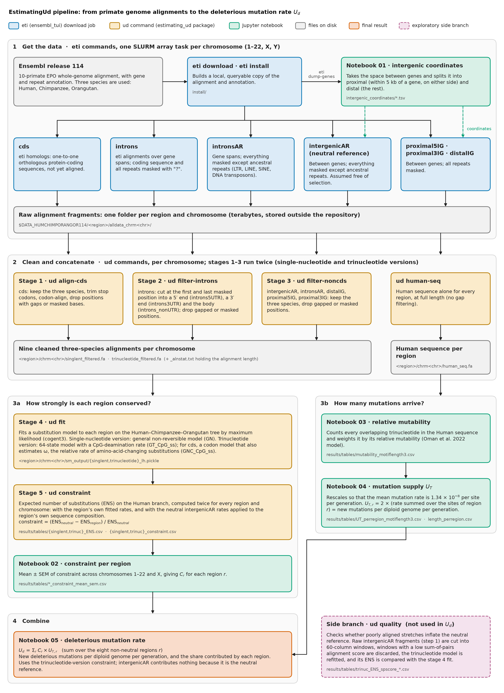

# EstimatingUd: what the pipeline computes, explained for a new reader

Drafted on 2026-11-23 with an AI assistant from a reading of this repository; check it against the code before citing it.
Sources read: `CLAUDE.md`, `README.md`, `pyproject.toml`, all of `src/estimating_ud/`, the five files in `docs/`,
all wrappers in `scripts/`, notebooks 01 to 05 and the exploratory notebooks, and the tables in `results/tables/`.
It describes the working tree of 2026-11-23, the state committed together with this file.
Nothing was re-run to write it; every number below is read from the saved tables.

## 1. The question in one paragraph

Every person is born with several dozen new mutations. Most do nothing; some are harmful. **U_d is the average number
of new harmful (deleterious) mutations per diploid genome per generation.** It cannot be counted directly, because
harmful mutations look like any other mutation when they arise. The pipeline estimates it indirectly from two quantities,
measured separately for each class of genomic region:

1. **How many mutations arrive** in the region each generation (the mutation supply, U_T).
2. **What fraction of them selection removes** over evolutionary time (the constraint, C).

U_d is the sum over regions of C times U_T.

## 2. Pipeline diagram



## 3. The idea behind each quantity

**Constraint (C).** Compare how fast a region actually changed along the Human lineage with how fast it would have
changed if nothing in it mattered. The "nothing matters" yardstick is intergenic ancestral repeats (`intergenicAR`):
old transposable-element copies lying between genes, assumed to evolve neutrally. If coding sequence shows 60% fewer
substitutions than the yardstick predicts, then roughly 60% of the mutations that hit coding sequence were harmful
enough for selection to remove them.

- The comparison uses three aligned genomes: Human, Chimpanzee and Orangutan. With three species, changes can be
  assigned to the Human branch specifically.
- Raw counts of differences would be biased, because regions differ in base composition and some sequence contexts
  mutate much faster than others (CpG sites in particular). The pipeline therefore fits a **substitution model**, a
  matrix of rates at which each nucleotide (or each trinucleotide) changes into another, by maximum likelihood.
- From a fitted model it computes the **expected number of substitutions (ENS)** on the Human branch. For each region
  it does this twice: with the region's own rates, and with the neutral (`intergenicAR`) rates applied to the region's
  own composition. The second number is what the region would have accumulated without selection.

```
constraint = (ENS_neutral - ENS_region) / ENS_neutral
```

**Mutation supply (U_T).** Count every trinucleotide in the Human sequence of the region and weight it by a published
relative mutability for that trinucleotide (Oman et al. 2022, doi:10.1093/gbe/evac032). The weights are then rescaled
so that the average over all sampled sites equals 1.34e-8 mutations per site per generation. Summing over the
region's sites and multiplying by 2 (two genome copies) gives U_T for the region, in mutations per diploid genome
per generation.

**Combination.**

```
U_d = sum over regions r of  C_r * U_T,r
```

`intergenicAR` is the neutral reference, so it has no constraint by definition and adds nothing to the sum.

## 4. The nine region classes

| Name in the code | What it is | How it is sampled |
| --- | --- | --- |
| `cds` | Protein-coding sequence | One-to-one orthologous coding sequences (`eti homologs`), codon-aligned by the pipeline |
| `introns_nonUTR` | Intron body | Gene spans with coding sequence and all repeats masked, between the first and last masked position |
| `introns5UTR`, `introns3UTR` | The two ends of each gene span | The same alignments, before the first and after the last masked position (see section 7) |
| `intronsAR` | Ancestral repeats inside genes | Gene spans with everything except ancestral repeats masked |
| `intergenicAR` | Ancestral repeats between genes: **the neutral reference** | Intergenic space with everything except ancestral repeats masked |
| `proximal5IG`, `proximal3IG` | Intergenic sequence within 5 kb of a gene | Intergenic coordinates from notebook 01, repeats masked |
| `distalIG` | The rest of the intergenic sequence | Intergenic coordinates from notebook 01, repeats masked |

## 5. Step by step

Everything runs per chromosome (1 to 22, X, Y) as SLURM array jobs on Puma, in one micromamba environment (`Udenv`,
Python 3.14, cogent3 2026.10.22). The alignments are terabytes and live outside the repository; every command finds
them through the `DATA_HUMCHIMPORANGOR114` variable (or the repository's `.env` file).

| Step | Command or notebook | What it does | Output | SLURM wrapper (memory / time requested) |
| --- | --- | --- | --- | --- |
| Download | `eti download`, `eti install` | Local copy of Ensembl 114 alignment and annotation | `install/` | run by hand |
| Coordinates | `eti dump-genes`, notebook 01 | Intergenic, proximal and distal coordinates | `intergenic_coordinates/*.tsv` | notebook |
| Region sampling | `eti homologs`, `eti alignments` | One folder of raw fragments per region and chromosome | `<region>/alldata_chrm<chr>/` | `scripts/download/*.sh` (16 GB / 2 days) |
| Stage 1 | `ud align-cds` | Rename species, trim stop codons, codon-align, drop gapped or masked positions | `cds/chrm<chr>/*_filtered.fa` | `01_align_cds.sh` (4 GB / 4 h) |
| Stage 2 | `ud filter-introns` | Split intron alignments into 5' end, 3' end and body; drop gapped or masked positions | three intron regions | `02_filter_introns.sh` (8 GB / 4 h) |
| Stage 3 | `ud filter-noncds` | Rename and filter the five remaining regions | five regions | `03_filter_noncds.sh` (8 GB / 4 h) |
| Human sequence | `ud human-seq` | Human sequence alone, all nine regions | `human_seq.fa` | `03b_human_seq.sh` (14 GB / 8 h) |
| Stage 4 | `ud fit` | Fit the substitution models | `sm_output/*_lh.pickle` | `04_fit.sh` (40 GB / 8 h) |
| Stage 5 | `ud constraint` | ENS and constraint, chromosomes 1 to 22 and X | `results/tables/*_ENS.csv`, `*_constraint.csv` | `05_constraint.sh` (30 GB / 4 h, single job) |
| Summary | notebook 02 | Mean and SEM of constraint across chromosomes | `*_constraint_mean_sem.csv` | notebook |
| Mutability | notebooks 03, 04 | Trinucleotide mutability, rescaling, U_T per region | `mutability_motiflength3.csv`, `UT_perregion_motiflength3.csv`, `length_perregion.csv` | notebook |
| U_d | notebook 05 | C times U_T, summed over regions | figures and values in the notebook | notebook |

Stages 1 to 4 are run in two versions. The **single-nucleotide** version (`singlent`) treats each base independently
and fits cogent3's general non-reversible model (`GN`). The **trinucleotide** version (`trinuc`) uses 64 trinucleotide
states with a separate CpG-deamination rate (`GT_CpG_ss`); for coding sequence it uses a codon model that also estimates
omega, the relative rate of amino-acid-changing substitutions (`GNC_CpG_ss`). Both models are defined in
`src/estimating_ud/models.py`. Notebook 05 uses the trinucleotide constraint.

There is also an **exploratory side branch** (`ud quality`, documented in `docs/pipeline_qualityaligned.md`). It asks
whether badly aligned stretches inflate the neutral reference: raw `intergenicAR` fragments are cut into 60-column
windows, windows with a low sum-of-pairs alignment score are discarded, the trinucleotide model is refitted, and its
ENS is compared with the stage 4 fit. Its output does not enter U_d.

## 6. Current output

These values are read from `results/tables/` as it stood in the working tree on 2026-11-23, and recombined exactly as
notebook 05 does. They match the outputs stored in the notebook.
Treat them as the pipeline's current output, not as a final estimate: section 7 lists open issues that affect them.

| Region | Constraint C (trinucleotide, mean of 23 chromosomes) | Human sites (Mb) | U_T | U_d contribution | Share of U_d |
| --- | --- | --- | --- | --- | --- |
| `cds` | 0.624 | 32.3 | 1.20 | 0.75 | 11.2% |
| `introns_nonUTR` | 0.201 | 635.8 | 16.70 | 3.35 | 50.3% |
| `intronsAR` | 0.107 | 596.8 | 16.28 | 1.74 | 26.1% |
| `introns3UTR` | 0.387 | 6.7 | 0.23 | 0.09 | 1.4% |
| `introns5UTR` | 0.382 | 6.7 | 0.23 | 0.09 | 1.3% |
| `proximal5IG` | 0.145 | 45.8 | 1.25 | 0.18 | 2.7% |
| `proximal3IG` | 0.145 | 45.9 | 1.25 | 0.18 | 2.7% |
| `distalIG` | 0.053 | 218.2 | 5.42 | 0.29 | 4.3% |
| **Total** |  | 1588.1 | 42.56 | **6.66** | 100% |

- U_d = **6.66** new deleterious mutations per diploid genome per generation, out of U_T = 42.6 new mutations in the sampled regions.
- The eight regions hold 1.588 Gb of Human sequence, 49.6% of a 3.2 Gb haploid genome (the denominator notebook 05 uses). The estimate covers that part only: `intergenicAR` contributes nothing by construction and the rest of the genome is not sampled.
- The four intronic classes together account for 79% of the total. Coding sequence has the highest constraint (0.62) but only 2.8% of the mutation supply.
- As an additional check, not something notebook 05 computes: the single-nucleotide constraint combined with the same U_T gives 6.68.

## 7. What to know before relying on the number

Open items already recorded in `docs/todo.md`:

1. **The "UTR" classes are not UTRs.** Coding sequence and repeats are masked with the same character, so the cut at the
   first or last masked position falls a few hundred bp from the transcript ends. `introns5UTR` and `introns3UTR` are both
   about 6.7 Mb genome-wide, whereas real 3' UTRs are several times larger than 5' UTRs.
2. **Two definitions of "site".** Constraint is estimated on filtered three-species alignment columns; U_T is computed
   from the unfiltered Human sequence. Notebook 05 multiplies one by the other.
3. **Unweighted averages across chromosomes.** The mutation-rate means give each chromosome equal weight
   regardless of its length; notebook 02 averages constraint the same way.
4. **Intron alignments with no masked position** are handled inconsistently by the three samplers and can be counted twice.
5. **The quality-filtered neutral reference has not been propagated.** The side branch compares only `intergenicAR`
   with itself; constraints have not been recomputed against the filtered reference.
6. The scale labelled "CpG" in both trinucleotide models is bound to omega. Stage 5 does not read it, so current
   values are unaffected.

Points noted while reading the code. They are readings of the source, not tested behaviour:

1. **5' and 3' labels ignore gene strand.** Notebook 01 fixes `strand = 1` and assigns "proximal 3'" to the first 5 kb of
   each intergenic gap and "proximal 5'" to the last 5 kb, by coordinate order. For genes on the minus strand the labels
   are reversed relative to the gene. The two classes have nearly identical constraint (0.145 and 0.145), which is
   consistent with mixed labels but does not prove it.
2. **Intergenic gaps between 5 and 10 kb.** For these, the notebook's arithmetic makes the two 5 kb proximal windows
   overlap and gives the distal interval a start beyond its stop. How `eti alignments` treats such rows, and how many
   gaps are affected, should be checked.
3. **Negative constraint is clipped to zero** in notebook 05, and the method attributes every shortfall in
   substitutions to purifying selection. Positive selection, or mutation-rate variation that the trinucleotide
   model does not capture, would bias C.

## 8. Where things are

| Path | Content |
| --- | --- |
| `src/estimating_ud/` | The package: `cli.py` (the `ud` command), `stages/` (one module per stage), `models.py`, `apps.py`, `regions.py` (names and paths), `config.py` (data and results locations) |
| `scripts/download/`, `scripts/slurm/`, `scripts/submit.sh` | SLURM array wrappers; submit from the repository root, for example `scripts/submit.sh scripts/slurm/04_fit.sh` |
| `notebooks/` | 01 to 05 in run order; `exploratory/` for the alignment-quality work |
| `results/tables/`, `results/figures/` | The only outputs kept in git |
| `docs/` | `pipeline_downloaddata.md`, `pipeline_filtering.md`, `pipeline_constraint_estimates.md`, `pipeline_qualityaligned.md`, `todo.md` |
| `tests/` | pytest suite on synthetic data; no real alignments needed |
| `archive/`, `unmantained_code/` | Earlier generations, kept for reference only |

## 9. Glossary

- **Ancestral repeat (AR):** a transposable-element copy inserted before the species split, generally assumed to evolve without selection.
- **Substitution:** a mutation that became fixed in a lineage and is therefore visible as a difference between species.
- **Substitution model / rate matrix (Q):** the rates at which each nucleotide or trinucleotide changes into each other one, estimated from an alignment and a tree.
- **Non-reversible model:** a model in which the rate A to G need not match the rate G to A, so the direction of change along a branch is informative.
- **CpG deamination:** the fast C to T change at a C followed by a G; the main reason sequence context matters for mutation rate.
- **ENS:** expected number of substitutions on a branch under a fitted model.
- **Constraint:** the fraction of the neutral expectation that is missing in a region.
- **U_T:** total new mutations per diploid genome per generation in a region. **U_d:** the deleterious subset.
- **eti:** the command of the `ensembl_tui` package, used to download and sample Ensembl alignments. **ud:** this package's command.
